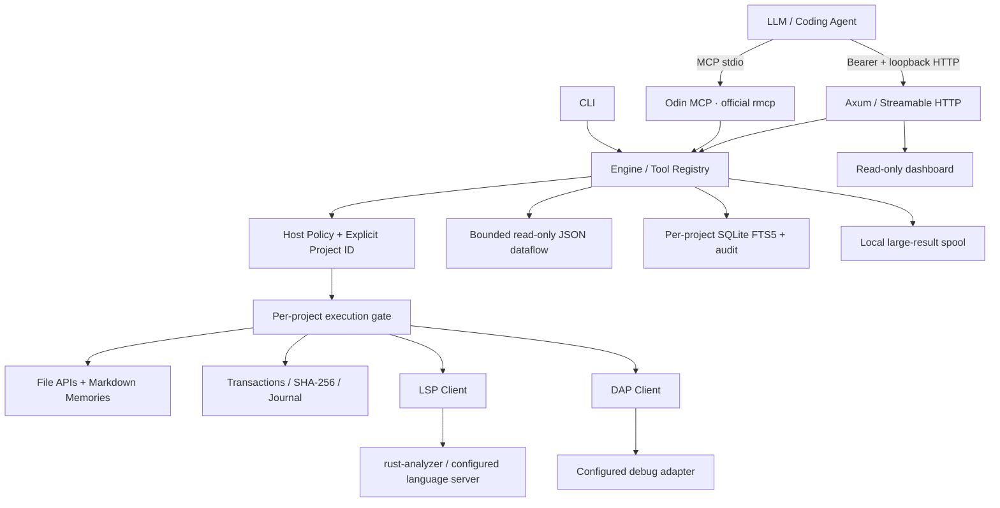
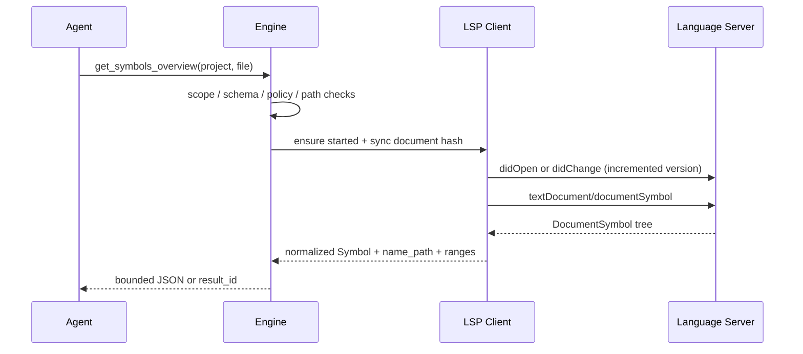
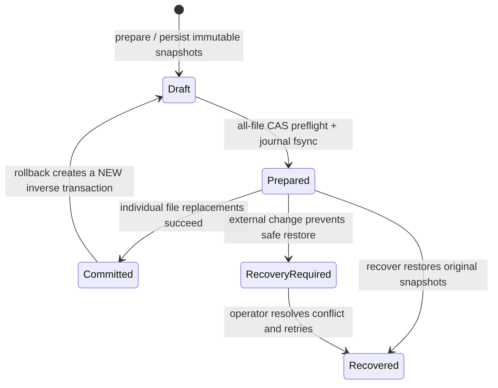

# Odin 0.2.0 Standalone — 完整架構設計

**文件狀態：與目前原始碼對應；Windows 實跑證據見 verification/local-validation.json。跨平台與完整 40 項驗收仍分開記錄。**

## 1. 系統定位

Odin 是讓既有 LLM / Coding Agent 使用的工具服務，不是自行訓練的大模型，也不是另做一個文字搜尋包裝器。把「編輯什麼、為何修改」留給 Agent；把專案隔離、符號查詢、修改前置條件、輸出限額及執行證據集中在 Rust 服務。

採四個 crates，而不是每個概念拆成空的 crate：

| crate | 實作責任 | 不負責 |
|---|---|---|
| `odin-core` | host config、路徑規則、檔案搜尋、FTS5、交易日誌、Markdown memories、MXC launch、受限程序執行 | MCP、LLM 推理、語言解析 |
| `odin-protocol` | subprocess RPC、LSP / UTF-16、DAP；不含外部 MCP 工具代理 | 策略授權、UI、宣稱 IDE 特例全覆蓋 |
| `odin-engine` | 工具契約、授權、project gate、工具分派、flow、結果分塊、命令與 inspection profile | 網路 listener、平台隔離實作 |
| `odin-agent` / binary `odin` | CLI、官方 rmcp MCP server、Axum HTTP、Dashboard | 直接繞過 engine 寫檔 |

核心沒有 Serena 或 Python runtime 相依。Python 只用於交付檢查／測試 fixture；自行選用的 LSP／DAP 後端仍可能有自己的 runtime 要求。

## 2. 元件圖



沒有 Serena 分支或執行失敗後的上游 fallback。LSP／DAP 是直接後端；host 未配置 sandbox 時仍具主機程序權限。配置 native MXC 後，LSP、DAP、固定命令與 inspection 經相同的 fail-closed ProcessContainer launch；Rust API 的路徑政策另行生效。見 [OS 沙箱](OS_SANDBOX.md)。

## 3. 啟動與生命週期

`Config::load` 讀 host TOML，canonicalize 根目錄、檢查 ID、limits、命令與重疊根目錄；若 config/state 在 workspace 內，自動加入原生路徑保護。`Engine::new` 建立 private state、每個專案的 journal/store 及共用 memory service。CLI 選擇 stdio 或 loopback HTTP；沒有背景 daemon 自動安裝，也不修改使用者的全域 MCP 設定。

LSP、DAP 依需求啟動。每個 `(project_id, language_id)` 使用各自 LSP；每個 project 有自己的 DAP session。關閉時先嘗試標準 shutdown/disconnect，再清理 RPC task 與 process tree。Windows Job Objects／Unix groups 管理生命週期；選用 MXC 的 workload 在執行前進入 OS 邊界，policy/scratch guard 保留至 tree close 與 parent reap。未選用 MXC 的程序只有原生命週期控制。

所有可改變專案的請求先進入 `Engine::run`。每次指定 project，沒有全程序可變的 active_project。啟動後不允許 Agent 新增任意 root；更改 host config 需重啟。不同 project 的語意範圍分開；此版未提供使用者身分／多租戶 ACL。

## 4. MCP 服務層

主服務採官方 Rust SDK `rmcp`，不是自行手刻整個 MCP server。此版應用層明確協商 `2024-11-05`、`2025-03-26`、`2025-06-18`、`2025-11-25`，沒有因 SDK 支援更新規格就宣稱 Odin 全部實作更新規格。

提供工具 list / call。工具 schema 與 policy 由同一份 catalog 生成；CLI、MCP 和 flow 最終共用 engine。工具執行失敗回傳 `isError` 與結構化 code，不把 backend 錯誤包成空成功清單。未知工具使用 protocol error。未宣告 resources、prompts、sampling、tasks 等未實作能力。

HTTP 使用 SDK 的 StreamableHttpService；在進入服務前要求 Bearer、loopback、Host / Origin 檢查及 request body 上限。Dashboard 頁面本身是靜態內容；讀取專案與稽核資料仍需 token。此版沒有公網 TLS / OAuth 部署。

## 5. 符號引擎

語意資料由真正的 LSP 伺服器提供。Odin 不用 Regex 冒充語意解析，不自行重造 Rust compiler AST。



符號結構保留 name、kind、階層 name_path、file、range 與 selection_range。定位函式使用 definition / declaration；引用使用 references；實作用 implementation；type hierarchy / code actions 在對端宣告支援時才呼叫。IDE 查詢包含 completion/resolve、hover、signature、workspace symbols、call hierarchy、semantic tokens 與 inlay/resolve。格式化 edit 轉成 expected-hash transaction。缺少 capability 會回 `CAPABILITY_UNAVAILABLE`，回覆附來源 hash/version 與 freshness。見 [IDE](IDE_IMPLEMENTATION.md)。

文件變更以 SHA-256 決定是否同步，version 單調遞增。與 LSP 的位置統一 **UTF-16、0-based**；轉 Rust UTF-8 byte offset 時拒絕切在 surrogate pair 中間，並處理 CRLF。文字行工具則採 1-based inclusive，兩者不混用。

查詢 diagnostics 優先 pull；否則讀取 push cache，標示 version 是否驗證。尚未收到 diagnostics 回報 pending，不當作「零錯誤」。真實後端的索引準備、workspace 特例、錯誤恢復仍需各語言整合驗收。

## 6. 修改與恢復



`Change` 三個欄位：path、expected_sha256、content。hash 為 null 表示只能新增；content 為 null 表示刪除。既有內容必須提供確切 hash。snapshot 讀於 prepare，apply 前再檢查全部檔案，寫入每個檔案前亦重檢。

transaction journal 儲存完整 before / after；prepare 回 diff，不寫來源。apply 先持有專案交易鎖，檢查舊內容、持久化 Prepared，再逐檔同目錄 tempfile + rename。失敗後只在目前內容仍等於已知 before 或 after 時還原，絕不為了顯示 rollback 成功而覆蓋第三方修改。

journal 的 committed replay 具有冪等效果；request_id 只可重用相同輸入；rollback 產生反向 journal，不修改歷史記錄。中斷後須明確 recover；不在啟動時靜默逆轉使用者工作。

**限制：沒有跨檔案瞬間原子可見性，外部程式不受 Odin 鎖限制。** 原生 I/O 改用 pinned directory/no-follow handles，Windows canonical identity、8.3、junction／hardlink 有回歸；最後 CAS 與 rename 間的外部競態、全部磁碟故障仍未被宣稱解決。Snapshots 總量上限 32 MiB。

LSP rename／CodeAction 先取得有界來源快照，檢查版本，把有序 text edits／CreateFile／RenameFile／DeleteFile 折疊成一份 CAS Change 流程。只接受 regular UTF-8 files／既有父目錄；拒絕 overwrite、recursive、binary、directory 和需確認 annotation。

## 7. 記憶、搜尋與資料存放

```text
<host state>/
  projects/<id>/
    index.sqlite3             # lexical FTS5 + metadata-only audit
    transactions/<uuid>.json   # immutable before/after and phase
    transactions/keys/         # idempotency key -> journal mapping
    results/<uuid>.json        # oversized results, read by result_read
  memories/
    global/<topic>.md
    projects/<id>/<topic>.md
  memory_transactions/         # shared journal for cross-note ref updates
```

Markdown memories 由名稱及 `mem:` 引用串接。先列名稱、再按需讀內容；沒有自動把全部記憶注入 prompt，也沒有向量資料庫。支援 CAS 寫入、刪除、同 scope 改名與引用更新、搜尋、完整性檢查與 read-only patterns。遇到需要修改唯讀引用的 rename，整個操作拒絕，不留下部分更新。

記憶放 host state，提供 versioned create-only import/export 與 reference-safe scope move，預覽 journal 綁定 initiating project。跨 project local 引用不能表達時拒絕。Repo-local 自動搬移與完整 ignored patterns 尚未實作。

索引是 **詞彙 FTS5，不是向量／語意 RAG**。`index_build` 可重建，query 前以 live hashes 增量 reconcile 新增、修改與刪除。沒有背景 watcher，掃描成本尚未做大型 repo benchmark。

## 8. 原生批次介面

`flow_run` 為受限 JSON dataflow，step 可呼叫允許的 native read tool、引用先前變數、使用 JSON Pointer 或截取陣列；沒有 import / eval / shell / 寫檔、無任意迴圈。所有步驟仍重新經過 engine policy。變數以 `(project, session)` 隔離，有限 steps / bytes / sessions；整條流程成功才提交 namespace。

每個 `(project,session)` 有自己的 mutex；全域 map 鎖不跨 await。map/filter/reduce、reference expansion、namespace/return 有 byte/node/depth 預算，clone 前檢查。這不是 Python REPL 或完整 DAG scheduler，不提供 eval／上游回退。

## 9. 除錯與命令執行

DAP 透過標準 Content-Length framing；使用 host 設定的 adapter profile。launch / attach 送出 frame 後即回 ticket，不等待 debuggee 完成設定，避免阻塞後續 configurationDone。events 與 launch 結果由 debug_events 收取。

支援 breakpoints、threads、stack、scopes、variables、evaluate、continue、step、pause、disconnect 等允許命令。未實作 IDE run configuration 自動探索、GUI 操作或 JetBrains debug REPL 語法轉譯。adapter 的能力與 launch arguments 仍由對應工具定義；其執行權限是特權，不是沙箱。

Shell 只接受 host 固定 program/argv profile，輸出有界、環境 allowlist，timeout 清理受管程序樹並回真實 status。程序清理不等於權限隔離。

## 10. 獨立產品邊界

生產 Rust 沒有 SerenaBridge／BridgeConfig／上游工具分支。MCP 只發佈自己的 72 個契約。`status` 明列 standalone／external_tool_bridge；doctor 預設 presence-only，`--probe-lsp` 才做真實 initialize，仍不把握手等同全索引完成。

`ProjectConfig` 保留 `deny_unknown_fields`；舊 bridge 設定不是靜默無效，而是載入錯誤。原生工具共用 engine、scope、policy 與 journal；外部 LSP／DAP、Shell 命令依舊需要可信任 host 設定，不是安全沙箱。

這是「去除 Serena 相依」的版本，不是「所有 Serena 功能已原生實作」的版本。JetBrains 專用工具沒有原生相容介面，Move／Inline、inspection parity 與 Python REPL 缺口明列於 `SERENA_PARITY.md`。一般 LSP references／rename／diagnostics 與 DAP primitives 提供部分同類用途，但不能視為 JetBrains backend 等價。

## 11. 「更好」如何驗證

設計目標是更可追蹤的修改、更少隱含共享狀態、可選的非任意程式批次介面與集中錯誤處理。不能只因使用 Rust 就推論整體更快或語意更準。

後續比較必須固定：同 repo commit、同 LSP/IDE 版本、同模型與 prompt、冷/暖索引、同樣完成條件。量測工具 round trips、輸出 bytes / tokens、P50/P95 latency、RSS、重構後 compile/test、衝突與復原結果。此版未執行這些實驗；實測欄均為 NOT_RUN。
